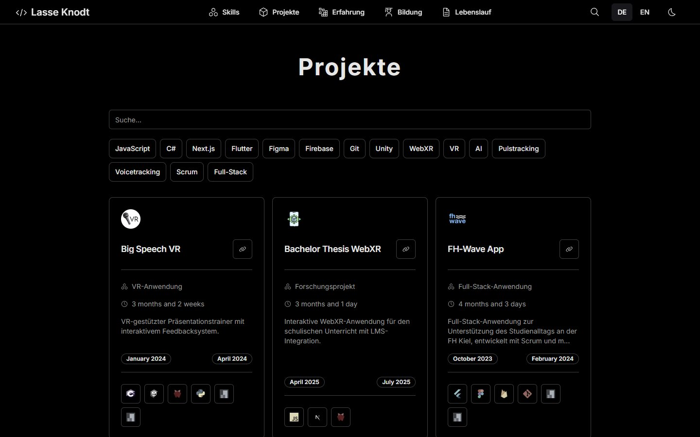
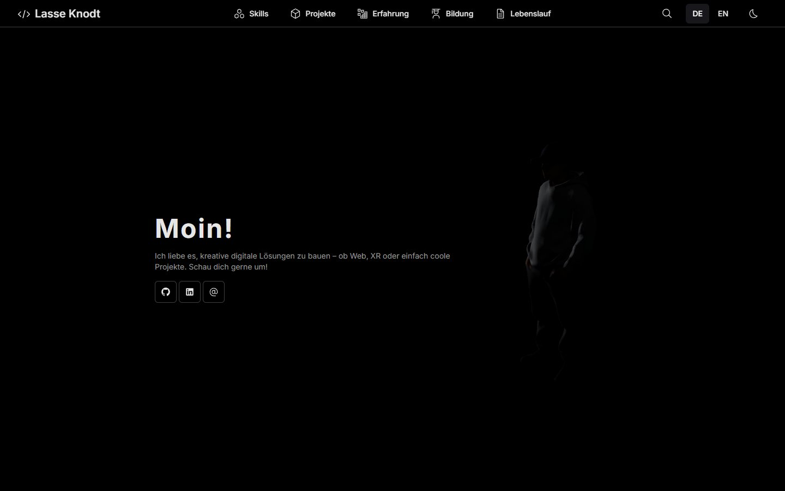
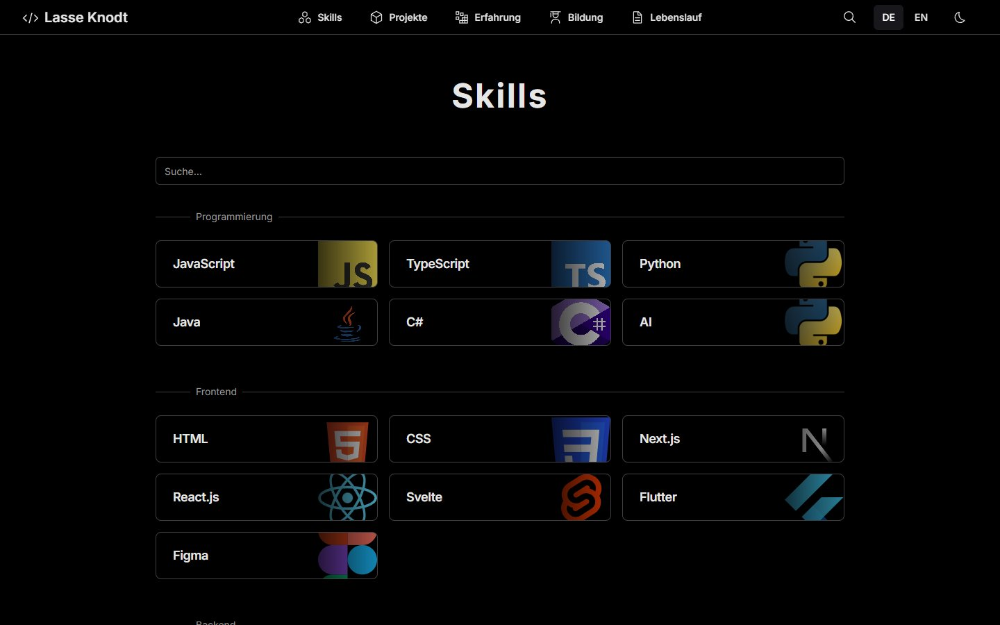
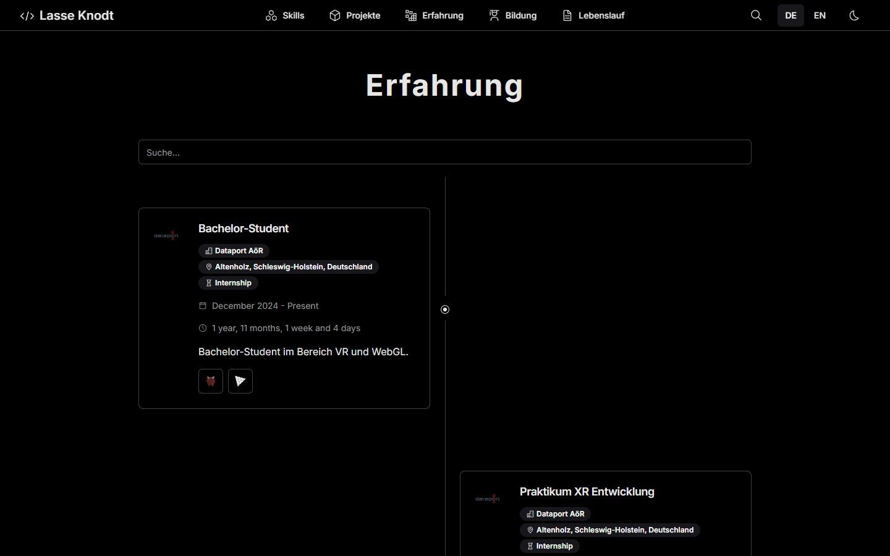

# Portfolio – Lasse Knodt

Mein persönliches Portfolio: Projekte, Skills, Berufserfahrung, Ausbildung und Lebenslauf – zweisprachig (Deutsch/Englisch), mit 3D-Avatar und Dark Mode.

**Live:** [portfolio-dbw3.onrender.com](https://portfolio-dbw3.onrender.com)



<table>
  <tr>
    <td width="33%"></td>
    <td width="33%"></td>
    <td width="33%"></td>
  </tr>
  <tr>
    <td align="center"><sub>Startseite mit 3D-Avatar</sub></td>
    <td align="center"><sub>Skills nach Kategorien</sub></td>
    <td align="center"><sub>Erfahrung als Zeitleiste</sub></td>
  </tr>
</table>

## Funktionen

- **Zweisprachig:** Umschalter DE/EN, alle Inhalte liegen lokalisiert in `src/lib/data/` (`LocalizedString`)
- **3D-Avatar** auf der Startseite: ein eigenes glTF-Modell, gerendert mit Three.js (`src/lib/components/3d/RotatingModel.svelte`)
- **Projekte, Skills, Erfahrung, Ausbildung** mit Detailseiten, Suche und Filter nach Technologien
- **Lebenslauf** als eigene Seite mit PDF-Download
- **Dark und Light Mode**
- Statischer Build (SvelteKit `adapter-static`) – läuft auf jedem Static Hosting

## Tech-Stack

| Bereich | Technologie |
| --- | --- |
| Framework | SvelteKit 2, Svelte 5, TypeScript |
| Styling | Tailwind CSS, UnoCSS (Icons), shadcn-svelte-Komponenten |
| 3D | Three.js |
| Build & Hosting | Vite, `@sveltejs/adapter-static`, Render |

## Lokal starten

Voraussetzung: Node.js (LTS) und npm.

```bash
git clone https://github.com/L4223/Portfolio.git
cd Portfolio
npm install
npm run dev
```

Die Seite läuft dann unter http://localhost:5173. Einen statischen Build erzeugt `npm run build` im Ordner `build/`.

## Inhalte anpassen

Alle Texte und Daten stehen in `src/lib/data/`:

| Datei | Inhalt |
| --- | --- |
| `home.ts` | Begrüßung und Social-Links |
| `projects.ts` | Projekte mit Beschreibung, Zeitraum, Links und Skills |
| `experience.ts`, `education.ts` | Berufserfahrung und Ausbildung |
| `skills.ts` | Skills und Kategorien |
| `resume.ts` | Lebenslauf |

## Herkunft

Das Grundgerüst stammt aus der Open-Source-Vorlage [slick-portfolio-svelte](https://github.com/RiadhAdrani/slick-portfolio-svelte) von Riadh Adrani (MIT-Lizenz). Darauf aufbauend habe ich unter anderem die Zweisprachigkeit, den 3D-Avatar, die Lebenslauf-Seite, eigene Logos und sämtliche Inhalte ergänzt.
